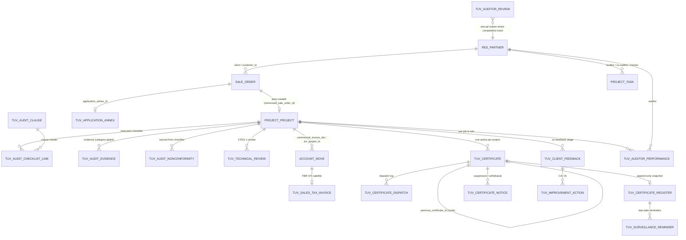

# Entity Relationship Design — TÜV Austria BIC

As-built model, verified at `Aug19` @ `9011b04`. The generic reference ERD from the
blueprint pack is kept at `docs/templates/ENTITY_RELATIONSHIPS.md`. Field-level detail
belongs in `docs/architecture/DATA_DICTIONARY.csv` (to be generated per module as specs are
written — see template `docs/templates/DATA_DICTIONARY_TEMPLATE.csv`).

## 1. Core certification chain (as-built)

Masters: `industry.ea.code`, `certification.standard`, `auditor.category`,
`service.category`, `unit.of.billing`, `employment.type`, `tuv.audit.document`,
`tuv.audit.clause`, `md.scheme` (+ `md.duration.line`, `md.adjustment.factor`,
`md.scheme.section`, `md.risk.category`).

Forms layer (`tuv_audit_reports`): ~22 line models, each with `plan_id` →
`tuv.audit.plan` (template record) **and** `project_id` → `project.project`
(live data), cascade delete on both.

## 2. Key integrity mechanisms already enforced (keep)

| Invariant | Mechanism |
|---|---|
| One active certificate per project | unique index ✅ |
| Certificate only after review + NC closure + 100 % payment | `create()` guard, sudo-proof ✅ |
| Reviewer independence (17021-1) | `@constrains` on technical review ✅ |
| Register immutability | `write()`/`unlink()` raise; controlled supersede flag ✅ |
| Preparer ≠ approver on dispatch | four-eyes check ✅ |
| STI uniqueness | unique `(company_id, name)` index ✅ |
| No certificate stage before full payment | `@constrains('stage_id')` ✅ |
| NC deadlines by grade | 3/6-month computed deadline + cron ✅ (durations hard-coded, CFG-001) |

## 3. Integrity gaps to close (proposed; IDs → backlog)

| Gap | Blueprint rule violated | Fix |
|---|---|---|
| Order↔invoice link only via `commercial_invoice_id`; SO lines unbilled (F-01) | §7.3 Order line ↔ invoice line M:N traceability | FIN-001: bill through SO lines |
| Money/man-days as Char (F-05) | §4.2 fixed-point money | FIN-002: Monetary/Float + migration |
| ~100 mirrored order fields on project (incl. legacy `rf_*`) | single source of truth | ARC-005: related/compute non-stored, or satellite model |
| Stage identity by display name | §4.2 never infer from display name | CFG-004: stage flags/xmlids (pattern exists: `requires_full_payment` flag ✅) |
| Product lookup by exact name | same | CFG-003: xmlid/default_code refs |
| No `company_id` on certificates, NCs, feedback, register | §4.3 company scope | SEC-003 with D-02 decision |
| Form line models cascade-delete from project | §7.3 never cascade-delete fiscal/audit history | review delete policy for submitted forms (ARC-008) |
| Surveillance cycle has no document link to next audit | §6.5 lifecycle traceability | OPS-001: register entry → auto-draft next order/project with `origin_ref` |
