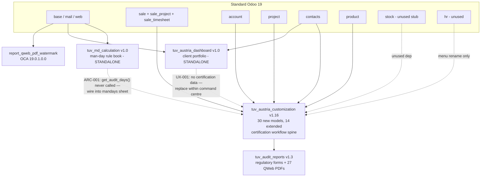

# Module Dependency & Integration Architecture — TÜV Austria BIC

Verified from `__manifest__.py` files and cross-module references at `Aug19` @ `9011b04`.
The generic conceptual map from the blueprint pack is kept at
`docs/templates/MODULE_DEPENDENCY_MAP.md`.

## 1. As-built dependency graph

**Rules observed:** no dependency cycles ✅; `tuv_audit_reports` is correctly layered on top
of the customization (it renders, the customization owns workflow data) ✅; two leaf modules
are currently disconnected islands ⚠️ (`ARC-001`, `UX-001`); `stock`/`hr` dependencies carry
no real usage ⚠️ (`ARC-006`).

## 2. Integration touchpoints between the modules

| From → to | Mechanism (verified) | Health |
|---|---|---|
| customization → standard sale/project | `reinvoiced_sale_order_id`, auto project creation, shared stages | ✅ real FK links |
| customization → standard account | commercial invoice created & posted on `account.move`; payment state computed from residual; `_reconcile_plan` hook | ⚠️ F-01 bypasses SO invoice status |
| forms → customization | `project.md_sale_order_id`, `md_*` fields, `nonconformity_ids`, `report_conclusion`, `group_planning_team` | ⚠️ regex-parses free-text man-days (F-05) |
| forms → project | every form mixin + line models (`plan_id`, `project_id` cascade) | ⚠️ very wide table (ARC-005) |
| md_calculation → anything | none | ⚠️ ARC-001 |
| dashboard → contacts | `_read_group` on `res.partner` | ✅ but domain-blind |

## 3. External integrations

| System | Status | Note |
|---|---|---|
| E-mail (SMTP) | Existing | 8 templates; feedback/report/invoice/notice mails |
| Public web | Existing | `/tuv/feedback/<token>` (public, CSRF, sudo — SEC-004 hardening) |
| FBR digital invoicing (Pakistan) | **Missing** | STI model is a manual stand-in; integration = ADR-006 decision |
| Banks / payment gateways | Unknown | no statement import config in repo |
| Accreditation bodies (PNAC/ESYD/SAAC) | Paper/PDF only | forms generated; no electronic submission exists |

Any new integration must be registered per blueprint §13 using
`docs/templates/INTEGRATION_CONTRACT_TEMPLATE.md`.

## 4. Target-state adjustments (proposed, approval required)

1. **ARC-001:** customization's mandays sheet calls `md.scheme.get_audit_days()`; typed
   numeric fields replace the ~80 Char fields (joint with FIN-002).
2. **ARC-002/003/004:** single checklist source feeding both NC sync and form rendering;
   one dispatch flow; one audit-report source feeding the FM-003 form.
3. **ARC-005:** split `project.project` form data into satellite models (one per form
   family) or keep mixins but move storage off the project table; measured by column count
   and form load time.
4. **ARC-006:** drop `stock`/`hr` deps or implement the intended feature (decision D-06).
5. New modules (e.g. client portal, FBR connector) enter as **separate addons** depending on
   `tuv_austria_customization`, never the reverse.
